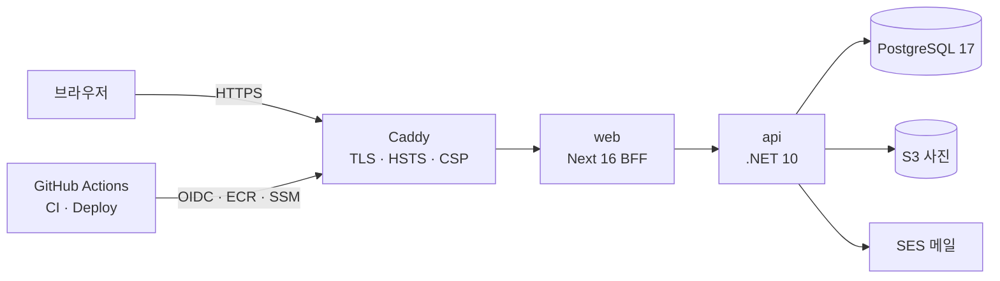

# nook - 장소 기록 서비스 백엔드 (C# .NET 재구축)

> 지도에 별자리를 그려 보세요.

**nook**은 가고 싶은 곳과 다녀온 곳을 지도에 기록하고, 한 줄 리뷰를 친구와 그룹으로 공유하는 위치 기반 SNS 목적의 서비스입니다.

원본은 Next.js + Supabase 기반 입니다. 저장이 여러 요청으로 나뉘어 있어서 중간에 끊기면 일부만 저장되고(부분 커밋), 동시에 들어온 요청이 그룹 정원을 넘기는(TOCTOU) 결함이 남아 있었습니다. 
이 리포는 그 백엔드를 C# .NET으로 다시 만들면서 트랜잭션 경계와 잠금을 직접 설계해 그 결함들을 수정해간 기록입니다.

고쳤다는 내용은 모두 측정으로 확인했습니다. 동시성 결함은 재현 테스트의 Before → After로, 운영은 AWS에 직접 배포해 롤백 · 복구 시간 · 요청 한도를 실측해 남겼습니다.

> 운영: `https://fillyournookwithstars.com` - **공개 준비 중**(개인정보 처리방침 확정 뒤 공개). 지금은 아래 화면과 문서로 확인할 수 있다.

<!-- TODO: "## 화면" 섹션 — PM 디자인 개편 후 추가(2026-11-13 결정). GIF 1개(지도 → 리뷰 → 그룹 합류) + 스크린샷 3장,
     docs/images/ 에 두고 테스트 계정으로 찍는다(실제 이메일·닉네임 노출 금지) -->

## 무엇을 해결했나

원본 nook에 있던 결함과 운영 준비 과정에서 찾은 문제를 **측정값으로** 확인하고 고쳤다. 자세한 과정은 각 문서에 있다.

| 문제 | 원인 | 해결 | 수치 | 문서 |
|---|---|---|---|---|
| 그룹 동시 합류에서 정원(4명) 초과 | 잠금 없는 확인 후 삽입(TOCTOU). `FOR UPDATE`를 걸어도 같은 문장의 JOIN이 옛 스냅샷을 읽음 | 잠금 문장과 읽기 문장 분리 | 동시 5명 → **6명 → 4명** | [incident 003](docs/incidents/003-그룹-동시-합류-정원-초과와-FOR-UPDATE-JOIN-스냅샷.md) · [ADR-010](docs/adr/010-group-join-concurrency.md) |
| 리뷰 동시 수정이 데드락(500), 고치자 두 수정이 섞여 저장 | DEFERRED 유일 제약의 커밋 시점 대기가 행 잠금과 순환. 잠금만 넣으면 늦은 수정이 앞선 수정을 덮음 | 리뷰 행을 먼저 `FOR UPDATE` + 낙관적 동시성 토큰 `version` | 데드락 **3/10 → 0/30**, 섞인 저장 **5/20 → 0/30** | [incident 002](docs/incidents/002-리뷰-동시-수정-데드락과-섞인-저장.md) · [ADR-011](docs/adr/011-review-version-round-trip.md) |
| 동시성 테스트가 결함을 지워도 통과 | "500ms 안에 안 끝났다"로 잠금 대기를 추측 | PostgreSQL에 잠금 대기 여부를 직접 조회(`LockWait`) | 변이 놓침 **5/20 → 0/20** | [incident 001](docs/incidents/001-시간-기반-대기-단언-거짓-통과.md) |
| 그룹 지도에 다른 멤버의 북마크가 안 보임 | 다른 멤버의 변경을 다시 불러오는 경로가 없음(연 순간의 스냅샷) | 화면으로 돌아올 때 다시 불러오기 | 반영까지 클릭 **2번 → 0번**, 복귀당 요청 1건 | [incident 004](docs/incidents/004-그룹-지도가-다른-멤버의-변경을-못-봄.md) |
| 같은 이메일로 로그인 메일 폭주 가능 | 개수 확인 후 삽입이 원자적이지 않음 | IP 입구 한도 + 이메일 한도 + 단일 소비자 발송 상한 | 운영 동시 100요청 → 429 **95**, 실제 메일 **3통** | [ADR-013](docs/adr/013-client-ip-trust-and-rate-limiting.md) |
| 서버 OS 보안 패치가 꺼져 있었음 | AL2023 저장소가 설치 릴리스에 고정 → 고정 기준 "밀린 업데이트 0" | 최신 릴리스 추적 + 매일 자동 적용 | 실제 밀린 보안 업데이트 **12개** 발견 | [dep-plan 10단계](docs/design/dep-plan.md) |

## 아키텍처



- 단일 EC2(t4g.small, arm64)에 docker compose로 Caddy · web · api · db를 올린다. DB 포트는 밖으로 열지 않는다.
- 배포: PR → CI(테스트 · 취약점 · 비밀값 검사) → `main` 병합 → arm64 빌드 → ECR(불변 sha 태그) → SSM이 서버에 배포 지시 → 헬스체크 실패 시 직전 버전으로 자동 롤백.
- 장기 AWS 액세스 키 0개: GitHub은 OIDC, 서버는 인스턴스 역할만 쓴다.
<!-- TODO: "- 전체 설계도(요청 · 배포 · 매일 운영 · 사고 대응): <링크>" — 설계도 아티팩트를 Share로 공개하거나 이미지로 내보낸 뒤 추가 -->

## 운영에서 실측한 것

| 항목 | 값 | 근거 |
|---|---|---|
| 서버 복구 RTO (스냅샷으로 루트 볼륨 교체) | **2분 39초** | [복원 런북 실행 기록](docs/design/restore-runbook.md) |
| 데이터 RPO | 24시간 (매일 04:00 덤프 → S3) | [dep-plan 9단계](docs/design/dep-plan.md) |
| 배포 실패 시 자동 롤백 | 일부러 깨진 배포로 확인 | [dep-plan 8단계](docs/design/dep-plan.md) |
| 비밀값 노출 | 리포 히스토리 · 이미지 4개 · 서버 로그 0건 (가짜 키로 검사기 동작 확인) | [dep-plan 10단계](docs/design/dep-plan.md) |
| 매일 점검 | 백업 · 스냅샷 · GuardDuty를 서버 밖(GitHub Actions)에서 확인, 실패 시 메일 | [.github/workflows/backup-check.yml](.github/workflows/backup-check.yml) |

## 기술 스택

| 영역 | 사용 |
|---|---|
| 백엔드 | .NET 10, ASP.NET Core, EF Core, PostgreSQL 17 |
| 테스트 | xUnit, Testcontainers(실제 PostgreSQL), WebApplicationFactory |
| 프론트 | Next.js 16 (BFF) |
| 인프라 | AWS EC2 · S3 · SES · ECR · SSM · Route 53 · DLM · GuardDuty, Caddy, docker compose |
| CI/CD | GitHub Actions, Trivy, gitleaks |

## 핵심 결정

| 결정 | 문서 |
|---|---|
| 계층 경계와 영속 모델 | [ADR-001](docs/adr/001-architecture-baseline.md) |
| 원본 스키마와 달라진 점 | [ADR-002](docs/adr/002-schema-differences-from-original.md) |
| 그룹 동시 합류: 그룹 행 비관적 잠금 | [ADR-010](docs/adr/010-group-join-concurrency.md) |
| 리뷰 쓰기: 이미지는 커밋 후 처리(트랜잭션 안 외부 I/O 금지) | [ADR-009](docs/adr/009-review-write-contract.md) |
| 클라이언트 IP 신뢰 고리와 요청 제한 위치 | [ADR-013](docs/adr/013-client-ip-trust-and-rate-limiting.md) |
| 컨테이너 배포 구성 | [ADR-003](docs/adr/003-container-deployment-layout.md) |

전체 ADR: [docs/adr](docs/adr)

## 로컬 실행

```bash
dotnet build
dotnet test        # 통합 테스트는 Docker가 필요하다(Testcontainers)
```
<!-- TODO: web 실행과 로컬 compose 실행 방법은 확인 후 채운다 -->

## 문서 지도

| 문서 | 내용 |
|---|---|
| [docs/개발_프로세스.md](docs/개발_프로세스.md) | 목표, 일정, 단계별 게이트 |
| [docs/design/dep-plan.md](docs/design/dep-plan.md) | 배포 계획과 단계별 실측 기록 |
| [docs/incidents](docs/incidents) | 트러블슈팅 기록 (Before / After) |
| [docs/adr](docs/adr) | 설계 결정 기록 |
| [docs/learning-log.md](docs/learning-log.md) | 날짜별 학습 기록 |
