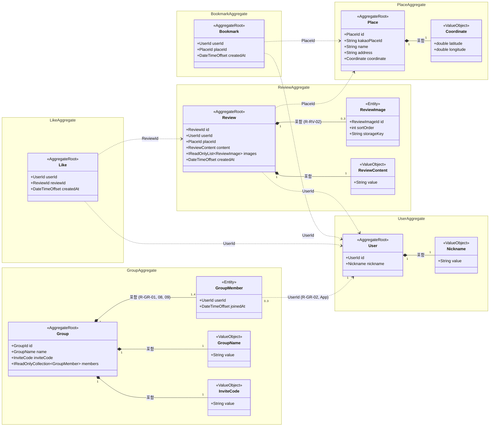

# 도메인 모델

## 1. 분류표

> 열 설명
> - **종류**: 엔티티 / 값 객체
> - **애그리거트**: 이 타입이 속한 애그리거트의 루트 이름. 자기 자신이 루트면 "루트"
> - **참조**: 다른 애그리거트를 가리키는 방법(ID로만 참조 vs 객체로 포함)
> - **지키는 불변식**: 이 타입(또는 루트)이 생성자·메서드에서 강제하는 규칙 ID. DB가 최종 보장하는 규칙은 `(DB)`로 표시
> - **근거**: 왜 이렇게 분류했는가 한 줄

<!-- 값 객체 4개는 D2에서 구현 완료 -->
> 표기: `(DB)` DB 제약·잠금이 최종 보장 / `(App)` 단일 애그리거트가 지킬 수 없어 Application 서비스가 확인

| 타입 | 종류 | 애그리거트 | 참조 | 지키는 불변식 | 근거 |
|---|---|---|---|---|---|
| User | 엔티티 | 루트 | Nickname을 값으로 포함 | R-US-02 (DB), R-GR-04 잠금 대상 (DB) | 다른 무엇에도 기대지 않고 존재하며, 그룹 합류 시 사용자별 직렬화 지점이 된다. 닉네임 유일성은 다른 회원과 비교해야 하므로 값 객체가 아니라 저장소가 보장한다 |
| Place | 엔티티 | 루트 | Coordinate를 값으로 포함 | R-PL-01 (DB), R-PL-02 | 카카오 장소 ID로 식별되는 독립 대상이며, 북마크·리뷰가 ID로 가리킨다 |
| Bookmark | 엔티티 | 루트 | UserId, PlaceId로만 참조 | R-BM-01 (DB), R-BM-02 (DB) | Place에 넣으면 인기 장소 하나에 수만 건이 쌓여 로딩·잠금 경합이 생기고, User에 넣어도 북마크 하나 바꾸려고 전체를 불러야 한다 |
| Review | 엔티티 | 루트 | UserId, PlaceId로만 참조 / ReviewContent·ReviewImage를 객체로 포함 | R-RV-01, R-RV-02, R-RV-03 (DB) | 작성·수정·삭제의 단위이고, 이미지 장수 제한을 자기 컬렉션만 보고 판단할 수 있다 |
| ReviewImage | 엔티티 | Review | Review에 객체로 포함 | (R-RV-02는 루트가 지킴) | 리뷰 없이는 의미가 없고 리뷰와 함께 생성·삭제된다. 순서·교체를 위해 식별자가 필요해 값 객체가 아니다 |
| Like | 엔티티 | 루트 | UserId, ReviewId로만 참조 | R-LK-01 (DB) | Bookmark와 같은 이유로 Review에 넣으면 인기 리뷰에서 경합이 생긴다 |
| Group | 엔티티 | 루트 | GroupMember를 객체로 포함 / GroupName·InviteCode를 값으로 포함 | R-GR-01, R-GR-03 (DB), R-GR-05, R-GR-06 (DB), R-GR-07 (DB), R-GR-08, R-GR-09 (App) | 정원 확인에 필요한 멤버 목록을 직접 가지므로 루트가 정원과 중복 합류를 미리 검사한다. 동시 합류의 선착순은 그룹 행 잠금이, 중복 합류는 (그룹, 회원) UNIQUE가 최종 보장한다. 초대 코드 유일성은 다른 그룹과 비교해야 하므로 저장소가 보장하고, 충돌하면 Application이 다시 생성한다. 생성자가 만든 회원을 첫 멤버로 넣으므로 멤버 없는 그룹은 만들어지지 않는다. 마지막 멤버의 탈퇴는 루트가 판정하지만 애그리거트 삭제는 저장소 작업이므로 Application이 같은 트랜잭션에서 그룹을 삭제한다 |
| GroupMember | 엔티티 | Group | Group에 객체로 포함 / UserId로만 참조 | R-GR-02 (App) | 그룹 없이는 의미가 없다. 회원당 3개 제한은 여러 그룹에 걸쳐 있어 어느 Group도 혼자 확인할 수 없으므로, User 행을 잠근 뒤(R-GR-04) Application이 참여 수를 센다 |
| Nickname | 값 객체 | User | User에 값으로 포함 | R-US-01 (NFC·trim, 2~12자, 한글 완성형·영문·숫자) | 식별자 없이 값으로만 비교되고, 생성 시점에 형식을 강제한다 |
| Coordinate | 값 객체 | Place | Place에 값으로 포함 | R-PL-02 | 위도·경도 한 쌍이 하나의 의미이며, 범위·NaN 검증을 한 곳에서 한다 |
| ReviewContent | 값 객체 | Review | Review에 값으로 포함 | R-RV-01 | 같은 텍스트면 같은 값이고, trim·코드 포인트 길이 검증을 담당한다 |
| InviteCode | 값 객체 | Group | Group에 값으로 포함 | R-GR-05 | 형식 검증과 생성(Generate)을 담당한다. 코드의 유일성은 값 자체가 아니라 저장소가 보장해야 한다 |
| GroupName | 값 객체 | Group | Group에 값으로 포함 | R-GR-10 (NFC·trim, 2~6자, 한글 완성형·영문·숫자·공백) | 닉네임과 같은 이유로 값 객체. 유일하지 않으므로 저장소 보장은 없다 |

### StarState가 표에 없는 이유

별 상태(R-STAR)는 저장하는 값이 아니라 (회원, 장소)의 Bookmark 존재 여부와 Review 존재 여부로 **계산되는 조회 결과**다. 저장하면 서로 다른 두 애그리거트가 바뀔 때마다 동기화해야 하고, 한쪽만 반영된 상태가 생길 수 있다. 따라서 도메인 타입이 아니라 조회 모델로 다루며, 성능을 위해 비정규화할지는 D3에서 결정한다.

## 2. 클래스 다이어그램

