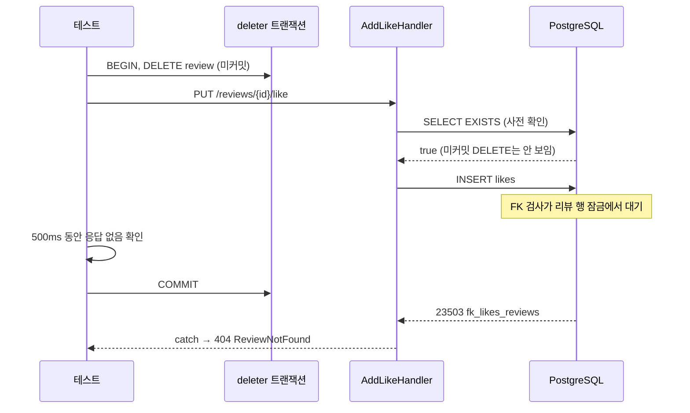
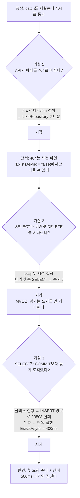
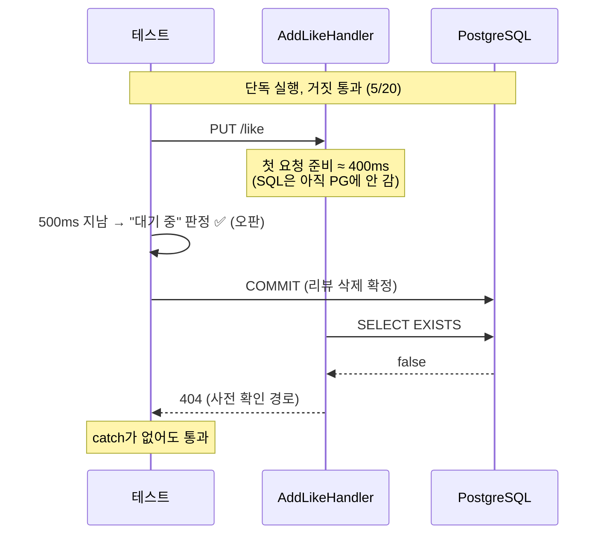
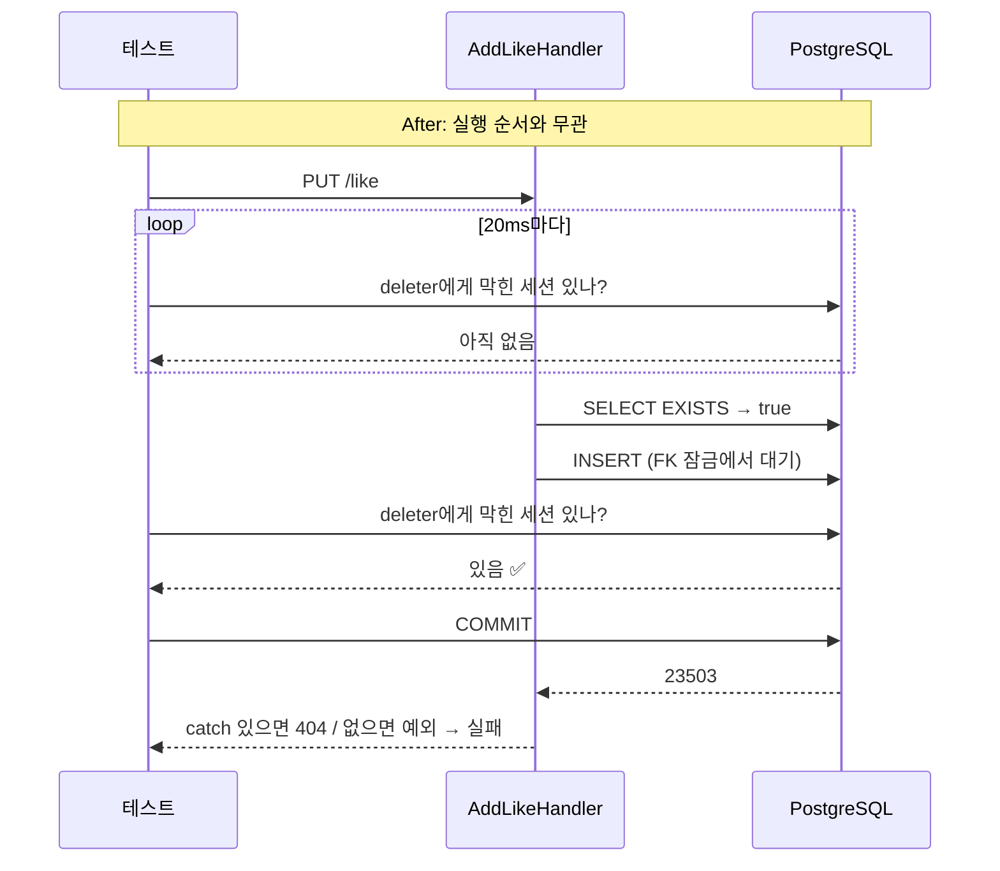

# 001. 동시성 테스트가 catch를 지워도 25% 확률로 통과했다

- 날짜 / 관련 커밋: 2026-10-23 / `b462fb2` · `4ed8507`
- 분류: 동시성 (테스트 신뢰성)
- 작성: Claude (사용자 요청)

## 1. 증상

- `LikeRepository`의 `catch`(23503 → `ReviewGone`)를 지웠다.
- 그래도 `Add_WhileReviewDeleteUncommitted_WaitsThenReturns404OnCommit`이 **통과**했다.
- 즉 테스트가 이 `catch`를 지켜 주지 못했다.
- 사용자 영향: 없음(테스트 문제). 하지만 `catch`가 사라져도 아무도 모른다 → 운영에서 500.

## 2. 재현

| 항목 | 값 |
|---|---|
| 환경 | 로컬 Windows, Testcontainers `postgres:17`, `WebApplicationFactory` |
| 변이 | `LikeRepository.TryAddAsync`의 `catch` 블록 삭제 |
| 명령 | `dotnet test tests/Nook.Integration.Tests --filter "FullyQualifiedName~Add_WhileReviewDeleteUncommitted_WaitsThenReturns404OnCommit"` |
| 재현율 | 단독 실행 **5/20 통과**(놓침). 클래스 실행은 놓치지 않음 |

테스트가 하려던 일:

## 3. 가설과 검증

| 가설 | 검증 방법 | 결과 |
|---|---|---|
| API가 예외를 404로 바꾼다 | `src`에서 `catch` 검색 | 기각. `catch`는 지운 그 하나뿐 |
| 일반 SELECT가 미커밋 DELETE를 기다린다 | psql 두 세션. A가 DELETE 후 미커밋, B가 SELECT | 기각. B는 즉시 `t`. INSERT만 대기 후 FK 위반 |
| SELECT가 COMMIT보다 늦게 실행됐다 | ① 클래스 실행 ② `Stopwatch` 계측 | 지지. 클래스 실행은 23503으로 실패. 단독 실행은 사전 확인이 COMMIT과 몇 ms 차이 |

## 4. 근본 원인

**"500ms 안에 안 끝났다"는 "잠금에서 기다린다"를 증명하지 못한다.**

계측값 (요청 출발 = 0ms):

| 구간 | 단독 실행 | 클래스 실행 |
|---|---|---|
| 핸들러 진입 | +112~169ms | +8~10ms |
| `ExistsAsync` 완료 | +512~591ms | +29~32ms |
| COMMIT | +516~540ms | +502~516ms |

- 단독 실행에서는 첫 요청이라 `ExistsAsync`가 약 400ms 걸린다. 첫 요청에만 드는 준비 비용 때문이다(세부 내역은 측정 안 함).
- 그래서 사전 확인 SELECT와 COMMIT이 몇 ms 차이로 겹친다.
- SELECT가 COMMIT 뒤에 실행되면 `false` → 404. **INSERT는 실행조차 안 된다.**
- 이때 `catch`가 없어도 결과는 똑같이 404다. 그래서 통과한다.

**왜 전에는 드러나지 않았나**

- `52481f0` 커밋 때는 전체 실행으로 확인했다.
- 전체 실행에서는 앞선 테스트가 호스트를 미리 데운다.
- 그래서 사전 확인이 +30ms에 끝나고, COMMIT까지 약 470ms 여유가 있었다.

## 5. 해결

**막힘을 시간으로 추측하지 말고, PostgreSQL에 직접 묻는다.**

- 파일: `tests/Nook.Integration.Tests/Infrastructure/LockWait.cs`
- 방법
  1. deleter 세션의 pid를 얻는다 (`pg_backend_pid()`)
  2. `pg_stat_activity`를 20ms마다 조회한다
  3. `wait_event_type = 'Lock'`이고 `pg_blocking_pids(pid)`에 deleter pid가 있는 세션을 찾는다
  4. 찾으면 그때 COMMIT한다. 그 전에 작업이 끝나면 실패. 10초 안에 못 찾아도 실패

**버린 대안**

| 대안 | 버린 이유 |
|---|---|
| A. 예열 요청 후 500ms 유지 | 여전히 시간 기반. 느린 CI에서 다시 흔들린다 |
| 대기 시간 늘리기 (500ms → 2s) | 느린 경우를 더 늦게 만날 뿐이다. 테스트도 느려진다 |

## 6. 결과 (Before → After)

조건: `catch` 삭제 변이, 단독 실행 20번.

| 지표 | Before (500ms) | After (`LockWait`) |
|---|---|---|
| 변이를 놓친 횟수 | **5/20 (25%)** | **0/20** |
| 사전 확인이 COMMIT 뒤에 실행된 횟수 | 5/20 | 0/20 |

같은 패턴인 `ConfirmPlaceTests` 2곳도 프로브로 확인했다.

| 프로브: B를 "DB 안 건드리고 600ms 뒤 null"로 교체 | Before | After |
|---|---|---|
| `TryAdd_WhileOtherInsertUncommitted_WaitsThenReturnsNullOnCommit` | 통과 (놓침) | 실패: "잠금 대기가 관찰되기 전에 작업이 끝났다" |

- 25%는 이 기계에서 잰 값이다. 첫 요청 준비 시간에 따라 달라진다.
- 수정 후 전체 테스트 172개 통과.

## 7. 재발 방지

- 대기 단언은 `LockWait.AssertBlockedByAsync`만 쓴다. 500ms 패턴은 0곳 남음(5곳 교체).
- 동시성 테스트는 **변이를 넣고 단독 실행**으로도 빨간불을 확인한다.
- 빨간불은 오류 메시지로 **의도한 단언**에서 났는지 확인한다.
  (이번에 리포지토리 변이가 A까지 깨뜨려 엉뚱한 단언에서 실패한 일이 있었다.)

## 8. 배운 것

- "아직 안 끝났다"와 "잠금에서 기다린다"는 다르다. 대기는 `pg_stat_activity`로 관찰한다.
- 일반 SELECT는 잠금을 기다리지 않는다(MVCC). 기다리는 건 잠금 읽기와 FK 검사 같은 쓰기다.
- C# 메서드의 완료 시각은 DB에서 SQL이 실행된 시각과 다르다.
