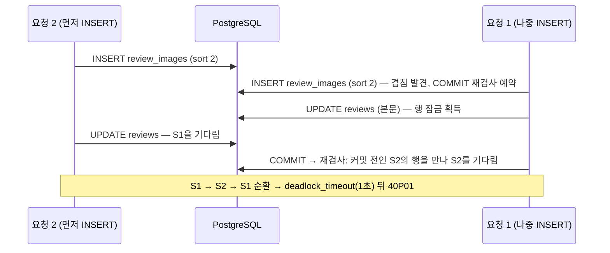

# 002. 리뷰 동시 수정이 데드락(500)으로 끝나고, 데드락을 고치자 두 수정이 섞여 저장됐다

- 날짜 / 관련 커밋: 2026-10-24 / `2e9b825`
- 분류: 동시성 (락 순서, lost update)
- 작성: Claude (사용자 요청). 실험 A·B·C는 사용자가 psql로 직접 실행했다

## 1. 증상

결함이 두 개 있었다. 첫 번째 결함 때문에 두 번째 결함이 드러나지 않았다.

**결함 1. 데드락**
- 같은 리뷰를 두 요청이 동시에 수정하면서, 둘 다 새 이미지를 붙이는 경우다(RV-02).
- 진 쪽은 409(6c)를 받아야 한다. 실제로는 가끔 **500**을 받았다.
- 오류는 `40P01: deadlock detected`였다.
- 이 예외는 Npgsql 실행 전략이 `InvalidOperationException`("transient failure")으로 감싸서 던진다. 그래서 리포지토리의 어떤 `catch`에도 걸리지 않았다.

**결함 2. 섞인 저장**
- 결함 1을 고치려고 리뷰 행 잠금을 넣었다.
- 그러자 남길 이미지가 서로 다른 두 수정이 **둘 다 200**을 받았다.
- DB에는 두 요청 중 어느 쪽도 의도하지 않은 상태가 남았다.

| | 요청 | 200 응답 |
|---|---|---|
| 요청 1 | `keep [A]` + n1 | `[A, n1]` |
| 요청 2 | `keep [B, C]` + n2 | `[B, C, n2]` |
| **DB** | | **`[n1@1, n2@2]`**: A·B·C가 모두 사라지고 sort 0이 비었다 |

사용자 영향(운영이었다면)은 다음과 같다.
- 결함 1: 같은 회원이 두 기기에서 동시에 수정하면 한쪽이 500을 받는다.
- 결함 2: 두 기기 모두 "수정 성공"을 받는다. 그런데 사진이 섞이거나 사라진다. **오류가 없어서 아무도 모른다.**

## 2. 재현

| 항목 | 값 |
|---|---|
| 환경 | 로컬 Windows, Testcontainers `postgres:17`, `WebApplicationFactory` |
| 동시성 고정 | `RendezvousStorage`(Barrier). 업로드 지점에서 두 요청을 만나게 해 "둘 다 조회를 마친 뒤 저장"을 고정한다 |
| 테스트 | `Edit_ConcurrentBothAppend_One200One409`(결함 1), `Edit_ConcurrentWithDifferentKeep_One200One409`(결함 2) |
| 명령 | `dotnet test tests/Nook.Integration.Tests --filter "FullyQualifiedName~Edit_Concurrent"` |
| 재현율 | 결함 1: 동시 테스트 2개를 함께 돌리면 **3/10**, 단독으로 돌리면 0/20. 결함 2: 잠금을 넣은 뒤 RV-02 테스트 전체를 돌리면 **5/20** |

결함 1은 앱 없이 psql 세션 두 개로 확정적으로 재현된다(실험 C).

```sql
CREATE SCHEMA lab; SET search_path = lab;
CREATE TABLE r  (id int PRIMARY KEY, content text);
CREATE TABLE ri (id int PRIMARY KEY, review_id int REFERENCES r, sort_order int,
  CONSTRAINT ux UNIQUE (review_id, sort_order) DEFERRABLE INITIALLY DEFERRED);
INSERT INTO r VALUES (1, 'before');
```

## 3. 가설과 검증

| # | 가설 | 검증 방법 | 결과 |
|---|---|---|---|
| 1 | t1이 INSERT하면 t2의 같은 `sort_order` INSERT가 **대기**한다. t1이 커밋하면 t2가 23505로 실패한다(사용자) | 실험 A: 두 세션이 INSERT만 실행 | ❌ **대기하지 않았다.** DEFERRED라 INSERT는 바로 진행되고, t2의 **COMMIT**에서 23505가 났다. 이 경로는 리포지토리가 409로 바꾸는 정상 경로다. 데드락은 설명하지 못한다 |
| 2 | 본문 UPDATE(reviews 행 잠금)가 두 번째 자원이다 | 실험 B: S1 INSERT → S2 INSERT → S1 UPDATE → S2 UPDATE → S1 COMMIT | S2의 UPDATE가 S1을 기다렸다. S1 COMMIT은 **아무것도 기다리지 않고 성공**했다. S2는 COMMIT에서 23505가 났다. 데드락은 없었다 |
| 3 | DEFERRED 재검사는 INSERT하던 순간 겹칠 수 있는 행을 본 쪽(**나중에 INSERT한 쪽**)만 예약한다. 그쪽이 본문 UPDATE를 먼저 잡으면 데드락이 난다 | 실험 C: B에서 **INSERT 순서만** 바꿨다(S2 먼저) | ✅ S1 COMMIT에서 `40P01`이 났다. `Process 382 waits for ShareLock on transaction 803; blocked by process 47. Process 47 waits for ShareLock on transaction 804; blocked by process 382. CONTEXT: while inserting index tuple in relation "ux"` |
| 4 | (결함 2) 행 잠금 뒤 늦은 쪽이 보내는 문장 중에 0행이나 23505가 나는 것이 없다 | 테스트를 계측해 두 요청 모두 200을 받은 실행의 DB 상태를 출력했다 | ✅ `[n1@1, n2@2]`. 아래 4절의 문장 표와 일치한다 |

단독으로 돌리면 0/20이었다. 이 차이는 가설 3으로 설명된다. 데드락은 "나중에 INSERT한 쪽이 UPDATE를 먼저 잡는" 순서에서만 생긴다. 프로세스가 막 시작해 JIT이 덜 된 상태에서는 두 요청의 저장 시점이 벌어지기 때문에, 이 순서가 거의 나오지 않는다.

## 4. 근본 원인

**결함 1.** `ux_review_images_review_sort_order`는 DEFERRED다. 그래서 커밋할 때 **숨은 대기**가 생기고, 이 대기가 행 잠금과 순환을 이룬다.



- 요청 1은 COMMIT 시점의 **DEFERRED 유니크 재검사** 때문에 요청 2가 끝나기를 기다린다.
- 요청 2는 **reviews 행 잠금(본문 UPDATE)** 때문에 요청 1이 끝나기를 기다린다.
- 이 대기는 코드 어디에도 보이지 않는다. DEFERRED는 순서를 다시 매기는 도중에 값이 잠깐 겹쳐도 되도록 넣은 것이다(erd.md). 그 대가로 생긴 대기다.

**결함 2.** 충돌을 **부수 효과로만** 감지하고 있었다(0행 또는 23505). EF는 바뀌지 않은 엔티티에 대해 문장을 보내지 않는다. 그래서 신호가 하나도 나오지 않는 조합이 생긴다. 요청 2가 먼저 커밋해 `[B@0, C@1, n2@2]`가 된 뒤 요청 1이 보내는 문장은 다음과 같다.

| 대상 | 요청 1이 보내는 문장 | 결과 |
|---|---|---|
| A | 없음(sort 0 그대로) | A는 이미 지워졌는데 신호가 없다 |
| B, C | `DELETE` | 행이 남아 있으므로(순서만 바뀜) 1행. 충돌로 보이지 않는다 |
| n1 | `INSERT sort 1` | 같은 트랜잭션에서 C(sort 1)를 지웠으므로 23505도 없다 |

**결함 2가 그전에 드러나지 않은 이유.** 잠금이 없을 때는 이 경합의 상당수가 결함 1의 데드락(500)으로 끝났다. 하나를 고치자 그 뒤에 있던 결함이 드러났다.

## 5. 해결

`ReviewRepository.TrySaveAsync`의 저장 트랜잭션을 바꿨다.

1. 트랜잭션을 연다. 그리고 `SELECT 1 FROM reviews WHERE id = ? FOR UPDATE`로 **리뷰 행을 먼저 잠근다**. 같은 리뷰를 수정하는 요청은 처음부터 한 줄로 서므로 순환 대기가 생길 수 없다.
2. **낙관적 동시성 토큰** `reviews.version`을 쓴다(`Review.Version`, `IsConcurrencyToken()`). `Review.Edit`가 성공할 때마다 +1이 되므로 `UPDATE reviews … WHERE version = <읽은 값>`이 **반드시** 나간다. 늦은 쪽은 0행이 되고, 리뷰가 남아 있으면 `Conflict`(409)로 끝난다. 본문만 바꾼 수정끼리도 감지한다.
3. 동시성 예외가 나면 먼저 `RollbackAsync`를 한다. 실패한 문장 뒤의 트랜잭션은 aborted 상태라서, 그 상태로는 "리뷰가 남아 있는가" 재조회를 할 수 없다.

잠금은 **언제** 실행될지를 정하고, 버전은 **실행해도 되는지**를 판단한다. 둘 중 하나만으로는 부족하다. 잠금만 있으면 결함 2가 남고, 버전만 있으면 결함 1의 순환이 남는다.

**버린 대안**

| 대안 | 버린 이유 |
|---|---|
| 40P01을 잡아 409로 반환 | 원인은 그대로 두고 증상만 덮는다. 데드락 탐지는 `deadlock_timeout`(1초) 뒤에야 일어나므로 진 쪽이 최소 1초 지연된다. 서버 로그에 ERROR도 남는다. 결함 2도 그대로다 |
| `EnableRetryOnFailure` 재시도 | 위 1초에 재시도 시간이 더해진다. 재시도 결과는 어차피 409라서 재시도할 가치가 없다 |
| 잠근 뒤 이미지 ID 집합 비교 | 스키마를 바꾸지 않아도 된다. 하지만 본문만 바꾼 충돌은 놓친다. 사용자가 버전 토큰을 선택했다 |
| 유니크 제약을 즉시 검사로 | 순서를 다시 매기는 도중에 값이 겹쳐 RV-02 자체가 실패한다(DEFERRED로 만든 이유) |

## 6. 결과 (Before → After)

| 지표 | Before | 잠금만 넣었을 때 | After(잠금 + version) |
|---|---|---|---|
| 동시 추가 500(40P01) | 3/10 | 0/20 | 0/30 |
| 동시 수정 둘 다 200(섞인 저장) | 데드락에 가려짐 | **5/20** | 0/30 |
| RV-02 테스트 10개 반복 | — | 15/20 통과 | **30/30 통과** |
| 변이: `IsConcurrencyToken()` 제거 | — | — | 동시 테스트 **6/15 실패**(잡아내기는 한다) |
| 같은 변이, 커밋 순서 고정 후(2026-10-26) | — | — | `keepBcCommitsFirst: True` **매번 실패**(`later` 200), `False`는 통과(0행 경로라 version 없이도 409) |

## 7. 재발 방지

- 테스트: `Edit_ConcurrentWithDifferentKeep_LaterSaveReturns409`(Theory — keep B·C 먼저 = version 경로, keep A 먼저 = 0행 경로), `Edit_ConcurrentBothAppend_One200One409`(sort_order 경로), `Edit_WhenReviewDeletedAfterRead_Returns404`(6b), `Edit_EachSuccess_IncrementsVersion`(도메인).
- 제약: `ck_reviews_version (version >= 0)`.
- 문서: erd.md의 reviews `version` 행, usecases.md RV-02 6c.
- **남은 약점:**
  - ~~변이를 잡는 비율이 6/15다.~~ 해소(2026-10-26). `OrderedGateStorage`가 랑데부(둘 다 조회 완료) 뒤 한쪽 업로드를 붙잡고, 테스트가 다른 쪽의 200 응답(= 커밋 완료)을 받은 다음 `TaskCompletionSource`로 풀어 준다. 두 순서를 Theory로 각각 고정했다.
  - ~~버전 검사는 **한 요청 안**(조회부터 저장까지)만 지킨다.~~ 해소(2026-10-26). `ReviewView`·`PlaceReviewView`에 `Version`(불투명 값)을 내려 주고 RV-02 폼의 필수 `Version`으로 돌려받는다. 핸들러가 권한 검사 뒤·업로드 전에 비교해 6c(409)로 거절하고, 그 뒤 경합은 저장의 version WHERE가 판정한다. 결정(사용자): 토큰은 `reviews.version`(xmin 아님), 바디 필드(ETag/If-Match 아님 — 단건 GET 없음), 409 재사용, 필수. 테스트 `Edit_WithVersionSeenBeforeOtherEdit_Returns409AndUploadsNothing`, `Edit_WithoutVersion_Returns400AndUploadsNothing`

## 8. 배운 것

- DEFERRED 제약은 검사를 **미룰 뿐 없애지 않는다.** 미뤄진 검사는 COMMIT 시점에 상대 트랜잭션을 기다린다. 이 대기는 코드에 보이지 않고, 다른 락과 엮였을 때만 드러난다.
- "0행이면 충돌"처럼 충돌이 부수 효과로 드러나기를 기다리는 감지에는 빈틈이 있다. 바뀌지 않은 엔티티는 문장을 만들지 않기 때문이다. 버전 토큰은 신호가 **반드시 생기게** 한다.
- 한 결함을 고치면 그 결함이 가리고 있던 다음 결함이 드러난다. 고친 뒤에도 같은 테스트를 반복 실행해야 하는 이유다.
